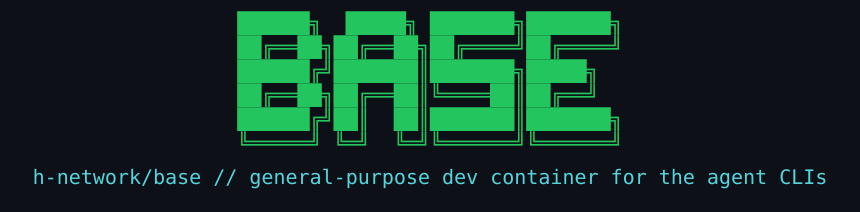

<div align="center">



<br/>

[](#-quick-start)
[](https://github.com/h-network/base/pkgs/container/base)

[](LICENSE)

[](https://github.com/h-network/base/actions/workflows/build.yml)


**A general-purpose development container: the Claude, Codex and Antigravity CLIs<br/>plus everyday dev tooling, on Ubuntu 24.04.**

Built for sandbox work — spin one up on any machine with Docker and get the same environment every time, without reinstalling toolchains by hand.

[Quick start](#-quick-start) · [What's inside](#-whats-inside) · [Helpers](#-helpers) · [Details](#-details-worth-knowing) · [Layout](#-layout) · [Walkthrough](https://github.com/h-network/base/wiki/Clean-install-walkthrough)

</div>

---

## 🚀 Quick start

Two ways to get it. Both give the same image.

<table>
<tr>
<th align="left">Pull the published image</th>
<th align="left">Build it yourself</th>
</tr>
<tr valign="top">
<td>

```bash
docker run -it --rm \
  ghcr.io/h-network/base:latest
```

No clone, no build.

</td>
<td>

```bash
git clone https://github.com/h-network/base.git
cd base
docker compose build
docker compose run --rm dev
```

</td>
</tr>
</table>

Published for `linux/amd64` and `linux/arm64`, so Docker pulls whichever matches
the machine. `:latest` tracks `main`; version tags (`:1`, `:1.2`, `:1.2.3`) are
published from git tags and are what you want to depend on — they do not move.

The agent layer — the CLIs, their config and the helper commands — is installed
by [h-agent](https://github.com/h-network/h-agent)'s installer and pinned by
`H_AGENT_VERSION` (default `main`), so a rebuild refreshes it to whatever that
ref specifies. A published tag is frozen at whenever it was built.

> [!TIP]
> New here? The **[clean-install walkthrough](https://github.com/h-network/base/wiki/Clean-install-walkthrough)**
> on the wiki runs the whole thing from nothing to a working agent, with the
> real terminal output at each step.

## 📦 What's inside

| | |
|---|---|
| **Agent CLIs** | `claude`, `codex`, `agy` — via [h-agent](https://github.com/h-network/h-agent) |
| **Agent helpers** | `h-agent`, `seedProfile`, `setupConfigDir`, `h-agent-capture` — via h-agent |
| **Dev** | `git`, `gh`, `python3`, `python3-venv`, `python3-pip`, `build-essential`, `jq`, `perl` |
| **Shell** | `tmux` (configured), `vim-tiny`, `openssh-client`, `sudo` |
| **Base** | `ubuntu:24.04`, UTF-8 locale; `smokeTest` for image self-check |

Roughly 480 MB.

## 🧰 Helpers

The helper commands are the [h-agent](https://github.com/h-network/h-agent)
project, installed into the image at build time rather than maintained here —
so an h-agent release is picked up by rebuilding (see
[Imported projects](#-imported-projects)). h-agent is licensed separately under
PolyForm Noncommercial 1.0.0.

### `h-agent` — launch a CLI with the container's defaults

```bash
h-agent           # $AGENT_CLI, default claude
h-agent codex
h-agent claude --resume     # extra arguments pass through
```

Each CLI spells "don't stop to ask me" differently — `--dangerously-skip-permissions`
for claude and agy, `--dangerously-bypass-approvals-and-sandbox` for codex.
`h-agent` knows which is which so you don't have to.

> [!WARNING]
> **Approval prompts are skipped by default**, because the flags above are meant
> for exactly this situation: a disposable container running as an unprivileged
> user. That assumption breaks the moment you bind-mount a host directory you
> care about — set `AGENT_SKIP_PERMISSIONS=0` to keep the prompts.

| variable | |
|---|---|
| `AGENT_CLI` | default CLI when none is named (default `claude`) |
| `AGENT_SKIP_PERMISSIONS` | `1` (default) skips approval prompts, `0` keeps them |
| `AGENT_CLAUDE_TOOLS` | claude's tool list (default `Bash Read Write Edit Glob Grep`; empty = unrestricted) |

Only claude can restrict its tool set from the command line — agy and codex have
no equivalent, so they run with their full set.

#### Pointing claude at a local inference endpoint

Supported for **`claude` only**. Describe the intent and `h-agent` translates
it into the several `ANTHROPIC_*` variables claude actually reads:

```bash
AGENT_PROVIDER_URL=http://10.0.0.5:8000 \
AGENT_PROVIDER_MODEL=some-model-id \
h-agent claude
```

| variable | |
|---|---|
| `AGENT_PROVIDER_URL` | endpoint base; a trailing `/v1` is stripped here, because claude appends `/v1/messages` itself |
| `AGENT_PROVIDER_MODEL` | model id, byte for byte as the endpoint serves it |
| `AGENT_PROVIDER_SMALL_MODEL` | optional, defaults to `AGENT_PROVIDER_MODEL` |
| `AGENT_PROVIDER_TOKEN` | optional; a placeholder is sent, since claude will not start without one |

All three model tiers are set from these, because claude picks a tier
internally — setting only some leaves the rest pointing at vendor model names
the endpoint does not serve, which claude reports as a *model* error. Any
inherited `ANTHROPIC_*` variables are cleared first, so a leftover key from a
previous subscription cannot quietly win.

> [!WARNING]
> **`codex` and `agy` refuse to start when `AGENT_PROVIDER_URL` is set**, and
> exit non-zero. Neither can be pointed at a local endpoint, and starting them
> anyway would run the agent against the vendor — different cost, different
> destination for your code, and nothing on screen to say so. Setting that
> variable states an intent, and failing it is an error rather than a fallback.

A successful run against a local endpoint still prints this once, on stderr:

```
[claude-code:unrecognized_model] {"model":"…","query_source":"generate_session_title"}
```

It is claude noting that the model is not one of its own while naming the
session, not a failure — the run continues and answers normally.

#### Command capture — a local log of what the agent ran

For claude and codex, `h-agent` records session boundaries and shell commands
to a local JSON Lines log, one record per hook event (`SessionStart`,
`SessionEnd`, and `PreToolUse` scoped to `Bash`). It is **on by default**.

```bash
AGENT_NAME=researcher h-agent claude   # tag this instance in the log
h-agent --log                          # print the log
h-agent --log claude                   # filter to one CLI, name, or session id
```

| variable | |
|---|---|
| `AGENT_CAPTURE` | `1` (default) logs hook events, `0` disables (claude and codex) |
| `AGENT_CAPTURE_FILE` | log path (default `~/.local/state/h-agent/commands.jsonl`) |
| `AGENT_NAME` | instance label recorded as `name` in each entry |

Commands and metadata only — prompts and tool output are never logged. The
hooks are injected per launch and write nothing under `~/.claude` or `~/.codex`.
The log is created mode `600`, but it is plaintext and a logged command can
contain a secret.

### `setupConfigDir` — a second config dir, seeded from your profile

```bash
eval "$(setupConfigDir work)"          # → ~/.claude-work + ~/.codex-work
eval "$(setupConfigDir work --same)"   # ...and copy the existing logins across
setupConfigDir                         # show what this shell is using
eval "$(setupConfigDir default)"       # back to ~/.claude and ~/.codex
```

Exporting `CLAUDE_CONFIG_DIR` by hand points the CLI at an **empty** directory,
so it quietly runs on stock defaults instead of the profile you set up.
`setupConfigDir` copies your profile in first — `settings.json`, `config.toml`,
and any `skills/`, `agents/` or `CLAUDE.md` beside them. Session history and
logins are left behind, which is what makes the new dir separate; `--same`
copies the logins too.

It changes `CLAUDE_CONFIG_DIR` and `CODEX_HOME` together. It prints the
`export`/`unset` lines rather than exporting them itself, so you `eval` its
output to switch the calling shell — and a new shell is back on the defaults.

### `seedProfile` — a config dir for one CLI, for callers that are not a shell

```bash
seedProfile claude work                      # → CLAUDE_CONFIG_DIR=~/.claude-work
seedProfile codex work                       # → CODEX_HOME=~/.codex-work
eval "$(seedProfile --export claude work)"
```

A CLI pointed at a fresh directory does **not** fall back to the defaults in
`~/.claude` — measured, not assumed: `CLAUDE_CONFIG_DIR=~/.claude-test claude`
stops on the theme picker. An automated caller that creates a directory and
starts an agent against it therefore gets a process that waits forever for a
keypress, and looks exactly like an agent with nothing to say.

`seedProfile` copies the defaults out of the live config dir at runtime, so
there is one source of truth rather than a second copy that drifts. Existing
files are never overwritten, and credentials are not copied — a seeded profile
is unauthenticated by design.

It differs from `setupConfigDir` in who it is for: that one prints `export`
lines you `eval` into your shell and moves both CLIs together; this one takes a
single CLI, changes no environment, and prints the variable to set.

`agy` is not supported and says so — it resolves its state relative to `HOME`
under `~/.gemini/antigravity-cli/`, with no variable to point it elsewhere.

### `h-agent probeProvider` — see what a local endpoint serves, and whether claude can use it

```bash
h-agent probeProvider http://10.0.0.5:8000              # list, then verify with the first id
h-agent probeProvider http://10.0.0.5:8000 some-model   # verify with a specific one
```

Lists model ids from `/v1/models` (vLLM and anything else OpenAI-shaped),
falling back to `/api/tags` for ollama, then POSTs to `/v1/messages` to check
claude can actually talk to it — serving models and implementing the route
claude uses are not the same thing.

The ids are printed rather than described because they have to match exactly;
an ollama tag like `gpt-oss:20b` mistyped as `gpt-oss-20b` comes back later as
a model error rather than as a typo.

It waits up to 90 seconds (`PROBE_TIMEOUT`) and reports "no answer" separately
from "not usable": a model loading cold can take tens of seconds, and treating
that as a verdict on the endpoint sends you to debug the wrong thing.

### `smokeTest` — check the entry points still exist

```bash
smokeTest        # exits 0, or lists what is broken and exits 1
```

Runs during the build and fails it, so an image that publishes has at least
been shown to have a working `h-agent`, all three CLIs on `PATH`, and config
files that parse. Re-runnable inside a container that is already up.

It proves only that those things exist and start — no model, no credentials, no
network — and it says so in its own output, because a green build here is easy
to read as more assurance than it is.

## 🔍 Details worth knowing

<details open>
<summary><b>Runs as <code>ubuntu</code> (uid 1000), not root</b></summary>

The agent CLIs misbehave under root — Claude Code refuses
`--dangerously-skip-permissions` there. `sudo` is available without a password.

</details>

<details open>
<summary><b>Nothing is bind-mounted by default</b></summary>

`compose.yaml` uses named volumes, so agent logins and `/workspace` survive
`--rm` without inheriting host file ownership. Work is expected to live in git,
cloned inside the container.

If you do bind-mount a host directory, note that the image is uid 1000 — on a
host where you are not uid 1000, writes will fail. Either `chown -R 1000:1000`
the directory or run with `--user $(id -u):$(id -g)`.

> [!NOTE]
> Those volumes persist `~/.claude` and `~/.codex`, where h-agent's installer
> seeds config at build time. A named volume is seeded only when it is **first
> created**, so after pulling or building a newer image, run
> `docker compose down -v` to recreate the volumes and pick up the re-seeded
> config. That also clears stored logins, so you re-authenticate afterward.

</details>

<details open>
<summary><b>Python packages need a venv</b></summary>

Ubuntu 24.04 is PEP 668 managed, so system-wide `pip install` is refused by
design:

```bash
python3 -m venv .venv && .venv/bin/pip install <package>
```

</details>

<details open>
<summary><b>The first-run dialogs are already answered</b></summary>

Each CLI opens on a dialog the first time it runs and waits for a keypress.
With nobody at the terminal that is indistinguishable from an idle agent — no
error, no exit code, no log line — so h-agent's installer answers them in
advance when it seeds the config:

| dialog | key | file |
|---|---|---|
| theme picker | `hasCompletedOnboarding` | `~/.claude.json` |
| bypass-permissions acceptance | `skipDangerousModePermissionPrompt` | `~/.claude/settings.json` |
| "Update available!" | `check_for_update_on_startup` | `~/.codex/config.toml` |
| "Do you trust this folder?" for `/workspace` | `hasTrustDialogAccepted` | `~/.claude.json` |

That seeded `~/.claude/settings.json` also turns off telemetry and error
reporting, blanks the `attribution` fields so nothing is added to commit
messages or PR bodies, and denies `mcp__*` so a cloned repository cannot
introduce tool surface you did not approve. `~/.codex/config.toml` sets
`approval_policy` and `sandbox_mode` so a `codex` run started directly, without
the `h-agent` wrapper, does not stall.

None of this is a login; the CLIs still ask you to authenticate.

> [!NOTE]
> The installer **merges** these defaults underneath whatever each file already
> contains — existing values win and are never overwritten. Your own settings
> survive; the flip side is that setting a key yourself also opts you out of any
> default h-agent later changes for it.

The trust prompt is keyed by absolute path, so only `/workspace` — the image's
`WORKDIR`, and where an agent starts unless told otherwise — is answered ahead
of time. Working anywhere else prompts once on first use.

</details>

<details open>
<summary><b>No credentials are baked into the image</b></summary>

Authenticate inside the container (`claude`, `codex`, `gh auth login`); the
compose volumes persist it.

</details>

## 📁 Layout

```
Dockerfile                  the image
LICENSE                     Apache 2.0
NOTICE                      what the licence covers, and what it does not
TRADEMARKS.md               trademark policy for the project name
compose.yaml                build + run, named volumes
h-app/smoketest.sh          → /usr/local/bin/smokeTest, and run during the build
h-app/tmux.conf             → ~/.tmux.conf (branded status badge + window title)
h-app/motd                  → /usr/local/bin/h-motd, the login banner
.github/workflows/build.yml builds, watches h-agent, and publishes to GHCR
assets/banner.svg           the banner above
assets/badges/              the badges above — self-hosted, not shields.io, so
                            the README fetches nothing outside github.com
assets/mkbadges.py          regenerates assets/badges/
```

base's own shipped files live in `h-app/`, mirroring the layout of the
[h-agent](https://github.com/h-network/h-agent) repo. The agent CLIs, their
config, and the `h-agent`/`seedProfile`/`setupConfigDir`/`h-agent-capture`
commands are **not** in this repository — the Dockerfile runs h-agent's
installer at build time, which places them under `~/.local/bin` and seeds the
config into the run user's home.

## 🚢 Cutting a release

Push a version tag; the workflow builds both architectures and publishes them.

```bash
git tag v1.2.3 && git push origin v1.2.3
```

`main` publishes `:main` and `:latest` on every push. There are no tarball
releases — the image is pulled from GHCR.

## 🧩 Imported projects

This repository is small on purpose: it prepares an environment and installs
almost nothing agent-specific itself. The whole agent layer — the CLIs, their
unattended config, and the launcher helpers — comes from **h-agent's installer**,
run at build time and pinned to one h-agent commit. Everything else is Ubuntu
packages. That split is what makes a rebuild the way to refresh things.

| project | what it provides | how it gets in | license |
|---|---|---|---|
| [h-agent](https://github.com/h-network/h-agent) | the agent layer: `claude`/`codex`/`agy`, their unattended config, and `h-agent`/`seedProfile`/`setupConfigDir`/`h-agent-capture` | its `install.sh`, run at build (ref pinned by `H_AGENT_VERSION`, default `main`) | PolyForm Noncommercial 1.0.0 |
| [Claude Code](https://github.com/anthropics/claude-code) | `claude` | via h-agent's installer (version pinned by h-agent) | Anthropic Commercial Terms |
| [Codex CLI](https://github.com/openai/codex) | `codex` | via h-agent's installer (version pinned by h-agent) | Apache 2.0 |
| [Antigravity CLI](https://antigravity.google/) | `agy` | via h-agent's installer (latest) | Google Antigravity Terms |
| [GitHub CLI](https://github.com/cli/cli) | `gh` | GitHub's apt repo (installed by base) | MIT |
| [Ubuntu 24.04](https://ubuntu.com/) | base image + packages | Docker Hub / apt (base) | mixed, per-package |

Because the CLIs now come through h-agent, `H_AGENT_VERSION` pins the **entire**
agent layer — CLI versions, helper scripts and seeded config — to a single
h-agent commit, so a given build is reproducible. Build with
`--build-arg H_AGENT_VERSION=<tag-or-commit>` to pin it; it tracks `main`
otherwise. `h-agent` is an h-network project like this one, but licensed on its
own separate terms (PolyForm Noncommercial), not under this repository's Apache
grant. Full terms are in [`NOTICE`](NOTICE).

## 📄 License

[Apache License 2.0](LICENSE). Every file in this repository carries an
`SPDX-License-Identifier: Apache-2.0` header, and the image declares
`org.opencontainers.image.licenses=Apache-2.0`. Brand names and marks are
governed by [`TRADEMARKS.md`](TRADEMARKS.md).

That covers this repository's own files — the Dockerfile, the `smokeTest`
script and the tmux config. It does **not** cover what the build installs into the image:
Ubuntu's packages, `gh`, the [h-agent](#-imported-projects) helpers, and the
three agent CLIs all keep their own terms. [`NOTICE`](NOTICE) has the details,
and the licence files ship inside the image at `/usr/share/doc/h-network-base/`.

> [!NOTE]
> The agent CLIs are not open-source components, and the h-agent helpers are
> licensed for noncommercial use only. Publishing an image built from this
> repository redistributes all of them, which the Apache grant here says nothing
> about — check each project's terms first.
